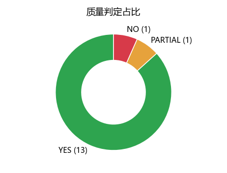
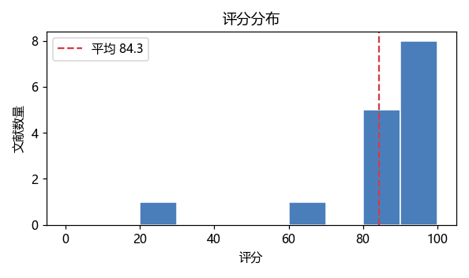

# MinerU × DataFlow-Agent：AI-Ready 数据自动化生产线

把 MinerU 解析后的金融文献，自动加工成**可评分、可筛选、可导出、可检索、可问答**的 AI-Ready 语料。

项目以 15 篇金融与金融科技文献为样例，完成正文清洗、内容去重、大模型质量评估、摘要生成、多格式语料导出和交互式报告，并进一步接入 BGE + BM25 + 术语共现图的本地 RAG 检索问答。最终得到 13 篇高质量语料、2,636 个检索块；8 道人工标注题的检索 Top-3 命中率为 87.5%。

入口：[快速开始](#快速开始) · [最终成果](#最终成果) · [实现思路](#实现思路) · [RAG 知识库与问答](#rag-知识库与问答) · [运行结果与评测口径](#运行结果与评测口径)

> 项目边界：PDF → 结构化 JSON 由 MinerU 在外部完成；本仓库从 `mineru_outputs/*.json` 开始，负责后续数据加工、质量管控、语料交付与检索问答。质量评估和可选的答案生成使用 OpenAI 兼容 API；索引构建、检索与检索评测均可离线运行。

## 目录

1. [项目背景](#项目背景)
2. [最终成果](#最终成果)
3. [技术栈选型](#技术栈选型)
4. [核心功能](#核心功能)
5. [整体架构](#整体架构)
6. [实现思路](#实现思路)
7. [工程化细节与踩坑](#工程化细节与踩坑)
8. [安装](#安装)
9. [配置](#配置)
10. [快速开始](#快速开始)
11. [分步使用](#分步使用)
12. [数据格式与评分规则](#数据格式与评分规则)
13. [RAG 知识库与问答](#rag-知识库与问答)
14. [运行结果与评测口径](#运行结果与评测口径)
15. [目录结构](#目录结构)
16. [当前边界与后续方向](#当前边界与后续方向)
17. [作者](#作者)

## 项目背景

非结构化 PDF 进入大模型训练或 RAG 流程前，通常要连续解决几件事：双栏正文顺序混乱、页眉页脚和特殊字符混入、同一文献重复入库、低质页面污染语料、处理中断后重复消耗 API 额度，以及语料导出后缺少检索验证。

这个项目把上述步骤连成一条可重复执行的生产线，而不是停留在“PDF 转文本”：

- 输入端兼容多种 MinerU JSON 结构，保留正文、公式和表格的结构化文本；
- 处理端完成 Unicode 清洗、正文抽取、内容指纹去重和 LLM 五维评分；
- 质量端把文献路由为 YES / PARTIAL / NO，并保留评分理由、摘要和异常标记；
- 交付端一次生成 JSONL、Markdown、CSV 和交互式 HTML 报告；
- 应用端用同一份高质量语料构建本地知识库，支持混合检索、带出处问答和命中率评测。

最终交付的不只是文本文件，还包括“为什么通过”“从哪里来”“如何复现”“检索是否命中”这些可追溯信息。

## 最终成果

仓库内已经保留一组完整处理结果，新克隆项目后可以不调用 API，直接重建语料、索引和报告。

| 成果 | 当前结果 | 对应文件 |
| --- | --- | --- |
| 批量质量评估 | 15 篇全部完成结果解析，13 YES / 1 PARTIAL / 1 NO | `output_results_batch.json` |
| 高质量语料 | 默认收录 13 篇 YES 文献，正文合计 462,720 字符 | `ai_ready_corpus/corpus.jsonl` |
| 多格式交付 | JSONL + 单篇 Markdown + Excel 可读 CSV | `ai_ready_corpus/` |
| 可视化报告 | 质量分布、评分分布、关键词图，支持筛选、搜索、排序 | `report.html`、`charts/` |
| 本地检索索引 | 13 篇文献切分为 2,636 块，使用 BGE 语义向量 | `data/rag_index/`（运行后生成） |
| 检索效果评测 | 8 道人工标注题，Top-1 与 Top-3 均命中 7 题 | `reports/retrieval_eval.md` |

| 质量判定分布 | 评分分布 |
| --- | --- |
|  |  |

`report.html` 是内嵌图表和样式、脚本自包含的静态页面，直接用浏览器打开即可，不需要启动 Web 服务。

## 技术栈选型

每个环节都尽量选择“能本地复现、能单独替换、结果能检查”的方案。

| 环节 | 当前方案 | 选择理由 |
| --- | --- | --- |
| PDF 版面解析 | MinerU（外部前置步骤） | 面向学术 PDF 的双栏、表格和公式场景，输出保留结构信息；本仓库不重复实现版面识别 |
| 解析结果适配 | Python 正则 + Unicode 规范化 | 同时兼容 `pdf_info`、`preproc_blocks`、`para_blocks` 和 `content_list`，便于处理不同 MinerU 导出结果 |
| 智能编排 | DataFlow-Agent `PipelineABC` + `PromptedGenerator` | 复用文件存储、批量生成和 API 请求服务，评估逻辑与调用流程分离 |
| 质量评估 | 智谱 GLM，默认 `glm-4.5-air` | 按统一提示词输出质量、分数、理由和摘要；模型与接口均可用参数覆盖 |
| 输出解析 | 标签定位 + 自洽性校验 | 容忍模型增加思考标签、调换字段顺序等格式波动，不让单篇脏输出中断整批任务 |
| 断点续跑 | 归一化正文 MD5 指纹 + JSONL 缓存 | 文件名变化不影响缓存命中；只有新增或正文变化的文档才重新评估 |
| 语义检索 | `bge-small-zh-v1.5` + NumPy | 中文模型较小，本地即可编码；向量归一化后用矩阵点积完成余弦相似度检索 |
| 词法检索 | jieba + BM25 | 补足纯向量检索对专有名词、模型名和精确术语的召回能力 |
| 多路融合 | RRF + 术语共现图 | 不直接混合不同量纲的原始分数；图谱作为第三路排名信号补充关联段落 |
| 索引存储 | JSONL + NPZ + JSON 元数据 | 无外部数据库依赖，文件可检查、可备份，适合中小规模本地语料 |
| 问答生成 | OpenAI 兼容接口，按需开启 | 默认先展示完整提示词和引用，只有显式添加 `--with-llm` 才产生生成 API 调用 |
| 报告 | 原生 HTML / JavaScript + 可选 matplotlib | 无前端框架和服务端依赖，离线打开也能筛选、搜索和排序 |

## 核心功能

### 1. MinerU 结果清洗与规范化

- 从嵌套 block / line / span 结构中提取正文，避免同一内容被重复拼接；
- 支持字典式和列表式 `content_list`，单独保留表格 `table_body`；
- 统一 NFKC 字符形式，清理零宽字符、BOM、控制字符、异常空白和多余空行；
- 对去空白后的正文计算内容指纹，自动跳过完全重复文档与空文本。

### 2. LLM 五维质量评估与摘要

- 从方法与识别、可复用信息、金融相关性、噪声控制、学术贡献五个维度评分；
- 输出 `QUALITY / SCORE / REASON / SUMMARY` 四个结构化字段；
- 按分数将文献分为 YES、PARTIAL、NO，默认只让 YES 进入正式语料；
- 评估失败自动重试，最终失败条目仍保留在结果中，便于定位而不是静默丢失。

### 3. 增量处理与成本保护

- 每篇成功结果立即追加到 `eval_cache.jsonl`，中断后可以从已完成内容继续；
- 缓存键来自正文内容而非文件名，同一内容改名后仍可复用；
- 批大小、批间等待、请求并发、请求重试和整批重试分别可调；
- RAG 问答默认只组提示词，不因一次检索测试意外调用付费模型。

### 4. AI-Ready 语料与报告交付

- JSONL 同时包含正文、摘要、质量、分数、理由和语言等元信息；
- 每篇文献另存 Markdown，便于人工检查和接入其他知识库工具；
- CSV 使用 UTF-8-SIG，Excel 打开中文不乱码；
- HTML 报告提供统计卡片、质量筛选、全文关键词搜索、点击排序和摘要展开。

### 5. 本地 RAG 检索与带引用问答

- 句子级切块、标题边界优先、块尾句子重叠，并给每块补充文献名与章节上下文；
- BGE 语义向量与 BM25 两路召回，RRF 融合排名；
- 术语共现图执行两跳衰减扩展，补充“文字不相似但术语相关”的候选；
- 回答提示词要求只依据资料作答，并用 `[编号]` 标注来源；
- 支持自动反查体检和人工标注 Top-K 命中率评测，未命中题目单独记录。

## 整体架构

```text
原始 PDF
   │
   │  MinerU：版面分析、正文/公式/表格提取（仓库外前置步骤）
   ▼
mineru_outputs/*.json
   │
   │  ① convert_mineru_jsons.py
   │     结构适配 → Unicode 清洗 → 空文本过滤 → 内容指纹去重
   ▼
input.json
   │
   │  ② homework1_final.py（需要 LLM API）
   │     DataFlow-Agent → 五维评分与摘要 → 标签解析 → 重试 → 内容缓存
   ▼
output_results_batch.json
   │
   ├──────────────► all_summaries.txt / summary_report_batch.txt
   │
   │  ③ export_ai_ready.py：默认筛选 YES，可选 PARTIAL 与最低分
   ▼
ai_ready_corpus/
   ├─ corpus.jsonl
   ├─ markdown/*.md
   └─ corpus_eval.csv
   │
   │  ④ rag_cli.py build
   │     句子切块 → BGE/TF-IDF 向量 → BM25 → 术语共现图 → 持久化索引
   ▼
data/rag_index/
   │
   ├─ query：混合检索，返回出处、章节、召回方式与片段
   ├─ ask：组装引用提示词，可选 LLM 生成答案
   └─ eval：自动体检 + 人工标注命中率

output_results_batch.json + input.json
   │
   │  ⑤ generate_report.py
   ▼
report.html + charts/*.png
```

`run_all.py` 按①→②→③→④→⑤串联执行；`--skip-eval` 跳过②，直接使用仓库已有评估结果，因此适合离线复现。

## 实现思路

### 数据适配层：先统一输入，再处理业务

`convert_mineru_jsons.py` 不假设所有 MinerU 输出都长一样：标准页面结构优先读取 `preproc_blocks`，不存在时回退到 `para_blocks`；块级存在 `content` 时不再重复读取子 span。对于 `content_list`，文本、表格和通用内容字段分别提取。

清洗只处理确定的字符与空白问题，不用激进正则删改正文语义。去重则在完整正文清洗后执行，避免仅靠文件名造成重复入库或误删。

### 评估层：把模型输出当作需要校验的外部数据

提示词约束四个字段，但解析器不假设模型一定严格照做：

1. 优先截取 `<answer>...</answer>`；
2. 按四个标签实际出现的位置切片，而不是按固定行号读取；
3. 清理残留的 `answer` / `think` 标签；
4. 将分数限制在 0–100；
5. 检查 `score` 与 `quality` 是否满足阈值关系，不一致时添加 `quality_score_mismatch`；
6. 缺字段或无法解析的条目进入重试，最终仍失败则保留 `parse_ok=false`。

质量与分数不一致时只标记，不擅自改写模型判定，让原始问题可追踪。

### 交付层：筛选规则与导出格式分离

导出先按 `parse_ok + quality + min_score` 筛选，再写不同格式，因此 JSONL、Markdown 和 CSV 使用同一批文献。`--min-score` 与质量条件是“同时满足”，例如默认情况下即使 PARTIAL 文献达到 90 分，也不会在未指定 `--include-partial` 时混入语料。

报告直接读取结构化结果，不重新调用模型。图表生成失败或被省略时，统计和交互表格仍然可用。

### 检索层：语义、精确词和关联关系互补

向量检索擅长改写与同义表达，BM25 擅长精确术语，两者分别产生排名后用 RRF 融合：

```text
RRF(d) = Σ 1 / (60 + rank_i(d))
```

图谱不是替代向量检索，而是从问题术语和向量 Top-3 块中提取种子，在术语共现图上做两跳扩展，再把相关块作为第三路排名参与融合。这样三路信号使用同一套排名语言，避免把余弦相似度、BM25 原始分和图权重直接相加。

## 工程化细节与踩坑

| 现象 | 根因 | 当前处理 |
| --- | --- | --- |
| 模型偶发调换输出字段顺序 | 固定按行或固定顺序解析过于脆弱 | 按标签位置切片，四个字段可乱序解析 |
| 思考标签混入摘要或理由 | 模型输出并非始终只有目标格式 | 优先提取 answer，清理残留 answer / think 标签 |
| 一批中少数失败导致结果数量对不上 | 失败项被直接忽略 | 失败项重试，最终保留占位与错误预览，输出顺序仍与输入一致 |
| 重跑全部文献造成重复 API 消耗 | 缓存按文件名或批次临时保存 | 使用正文内容指纹缓存，成功结果逐条追加，新增/变化内容才重评 |
| 同一文献换文件名后重复入库 | 文件名不是可靠的内容标识 | 转换阶段按去空白正文 MD5 去重 |
| 模型标签与分数冲突 | LLM 可能输出 `YES + 65分` | 自动添加不一致标记，报告中显示警示，不静默修正 |
| Windows 控制台偶发编码异常 | GBK 无法编码部分状态符号 | 各命令入口对 stdout / stderr 启用安全降级，不中断主流程 |
| 本机未安装 BGE 依赖 | 语义向量环境较重 | 自动退回字符 n-gram TF-IDF，也可用 `--backend tfidf` 显式选择 |
| 更换向量后端后继续读旧索引 | 不同模型向量空间不可混用 | 元数据记录后端，不一致时拒绝加载并要求重建 |
| 只想检查问答上下文却调用 API | 检索与生成绑定会产生不必要成本 | `ask` 默认只打印提示词，显式 `--with-llm` 才生成 |
| 评估结果不方便人工复核 | 纯 JSON 不利于筛选和比较 | 生成离线 HTML，支持筛选、搜索、排序、摘要与理由展开 |

## 安装

建议使用 Python 3.10 及以上版本；当前项目的实际运行环境为 Windows + Python 3.13。

```bash
git clone https://github.com/zhangyh066/MinerU-DataFlowAgent-AI-Ready-Pipeline.git
cd MinerU-DataFlowAgent-AI-Ready-Pipeline
python -m pip install -r requirements.txt
```

完整依赖中的智能评估包名是 **`dataflow-agent`**，不是 PyPI 上另一个名为 `dataflow` 的包。

按需安装两个可选组件：

```bash
# BGE 中文语义向量：不安装时会自动降级 TF-IDF
python -m pip install sentence-transformers

# PNG 图表：不安装时仍会生成 HTML 统计与交互表格
python -m pip install matplotlib
```

首次使用 BGE 且本地没有模型时，程序会把 `BAAI/bge-small-zh-v1.5` 下载到 `models/bge-small-zh-v1.5/`，约 100MB。也可以提前下载并通过 `RAG_MODEL_DIR` 指定模型目录。

如果只想基于已有结果离线运行转换、导出和 TF-IDF 检索，可以不安装 `dataflow-agent`，仅安装轻量依赖：

```bash
python -m pip install numpy jieba python-dotenv
```

## 配置

### 质量评估配置

复制 `.env.example` 为 `.env`，填入自己的密钥：

```dotenv
DF_API_KEY=你的密钥
```

`.env` 已被 `.gitignore` 排除，不要提交真实密钥。评估脚本会自动读取 `.env`，还支持以下可选配置：

```dotenv
MODEL_NAME=glm-4.5-air
API_URL=https://open.bigmodel.cn/api/paas/v4/chat/completions
```

同名配置也可用命令行 `--model` 和 `--api-url` 覆盖。

### RAG 与答案生成配置

RAG 命令读取进程环境变量。检索和评测不需要密钥，只有 `ask --with-llm` 需要。

| 环境变量 | 默认值 / 作用 |
| --- | --- |
| `RAG_MODEL_DIR` | 本地 BGE 模型目录；未设置时查找 `models/bge-small-zh-v1.5` |
| `RAG_EMBED_BACKEND` | `bge`（默认）或 `tfidf` |
| `RAG_CORPUS` | 语料路径，默认 `ai_ready_corpus/corpus.jsonl` |
| `RAG_INDEX_DIR` | 索引目录，默认 `data/rag_index` |
| `RAG_TOP_K` | 默认返回结果数，默认 5 |
| `RAG_CHUNK_SIZE` | 切块目标字符数，默认 300 |
| `RAG_CHUNK_OVERLAP` | 相邻块尾部重叠字符数，默认 60 |
| `RAG_LLM_PROVIDER` | `glm`（默认）或 `deepseek` |
| `RAG_LLM_MODEL` | 生成模型，默认 `glm-4.5-air` |
| `RAG_LLM_BASE_URL` | 可选，覆盖对应服务商的 OpenAI 兼容接口地址 |
| `RAG_LLM_API_KEY` | 可选通用密钥；优先使用服务商专用密钥变量 |
| `DF_API_KEY` | GLM 质量评估及 RAG 生成密钥 |
| `DEEPSEEK_API_KEY` | 切换 DeepSeek 后使用的密钥 |

例如，Windows PowerShell 中指定本地模型：

```powershell
$env:RAG_MODEL_DIR="D:\models\bge-small-zh-v1.5"
```

切换 DeepSeek 时同时指定服务商、模型和密钥：

```powershell
$env:RAG_LLM_PROVIDER="deepseek"
$env:RAG_LLM_MODEL="deepseek-chat"
$env:DEEPSEEK_API_KEY="你的密钥"
```

## 快速开始

### 方式一：不调用 API，复现仓库结果

仓库已经包含 `input.json` 和 15 篇文献的评估输出，可以直接执行：

```bash
python run_all.py --skip-eval --charts-dir charts
```

随后无需密钥即可检索和检查问答提示词：

```bash
python rag_cli.py query --query "金融科技对银行流动性创造的影响"
python rag_cli.py ask --question "监管沙盒试点如何影响实体企业创新？"
```

第二条命令默认展示将发送给大模型的资料、问题与引用编号，不会生成答案，也不会产生生成 API 费用。

### 方式二：从已有输入重新执行完整生产线

配置 `DF_API_KEY` 后运行：

```bash
python run_all.py --batch-size 1 --sleep 15 --max-retries 2 --charts-dir charts
```

该命令会实际调用质量评估 API。处理结束后打开 `report.html` 查看结果，或生成带引用回答：

```bash
python rag_cli.py ask --question "金融科技通过什么机制影响银行风险承担？" --with-llm
```

### 处理自己的文献

1. 使用 MinerU 将 PDF 解析为 JSON；
2. 将输出 JSON 放入 `mineru_outputs/`；
3. 执行 `python run_all.py`；
4. 语料内容发生变化后，执行 `python rag_cli.py build --force` 强制重建索引，避免继续查询旧索引；
5. 打开 `report.html` 复核低分、解析失败和质量/分数不一致条目。

## 分步使用

### ① 转换与清洗

```bash
python convert_mineru_jsons.py
python convert_mineru_jsons.py --input-dir mineru_outputs --output input.json --pattern "*.json"
```

输入是 MinerU JSON 文件目录，输出为 `[{"file_name": ..., "text": ...}]`。空文本与重复正文会跳过，单个文件读取失败不会阻止其他文件处理。

### ② 大模型批量评估

```bash
python homework1_final.py
python homework1_final.py --batch-size 5 --sleep 5 --max-retries 2
python homework1_final.py --max-workers 2 --retry-attempts 2
python homework1_final.py --model glm-4.5-air --cache-file eval_cache.jsonl
python homework1_final.py --no-cache
```

常用参数：

| 参数 | 含义 | 默认值 |
| --- | --- | --- |
| `--batch-size` | 每批文档数 | 1 |
| `--sleep` | 批次及重试轮次之间等待秒数 | 15 |
| `--max-retries` | 失败条目的额外整批重试轮数 | 1 |
| `--max-workers` | DataFlow 请求并发数 | 1 |
| `--retry-attempts` | 单次请求内部重试次数 | 1 |
| `--cache-file` | 内容指纹缓存文件 | `eval_cache.jsonl` |
| `--no-cache` | 不读也不写内容缓存，全部重评 | 关闭 |

提高批量或并发前应确认 API 限额；`--no-cache` 会重新消耗评估额度。

### ③ 导出语料

```bash
python export_ai_ready.py
python export_ai_ready.py --include-partial
python export_ai_ready.py --include-partial --min-score 85
python export_ai_ready.py --formats jsonl md csv --output-dir ai_ready_corpus
```

默认只导出 `parse_ok=true` 且 `quality=YES` 的文献。CSV 是所选语料的评估表，不包含正文；完整正文在 JSONL 和 Markdown 中。

### ④ 构建与查询 RAG 索引

```bash
python rag_cli.py build
python rag_cli.py build --force
python rag_cli.py build --backend tfidf --force
python rag_cli.py query --query "算法交易如何影响市场稳定性？" --top-k 5
```

`build` 默认复用已有索引，只有 `--force` 才强制重建。更换向量后端或更新语料后应显式重建。

### ⑤ 生成可视化报告

```bash
python generate_report.py
python generate_report.py --charts-dir charts
python generate_report.py --input output_results_batch.json --texts input.json --output report.html
```

不指定 `--charts-dir` 时，图表仍可内嵌进 HTML，只是不额外写出 PNG 文件。

## 数据格式与评分规则

### 清洗后的统一输入

```json
[
  {
    "file_name": "MinerU_json_example.json",
    "text": "清洗后的完整文献正文"
  }
]
```

### 单篇评估结果

```json
{
  "file_name": "MinerU_json_example.json",
  "quality": "YES",
  "score": 90,
  "reason": "研究方法清晰，机制与实证信息完整。",
  "summary": "文献摘要……",
  "parse_ok": true,
  "raw_result_preview": "QUALITY: YES ..."
}
```

解析失败时 `quality / score / reason / summary` 可以为空，`parse_ok=false`，同时保留原始输出预览。出现阈值冲突时还会增加 `quality_score_mismatch=true`。

### 五维评分

| 维度 | 分值 | 关注点 |
| --- | ---: | --- |
| 方法与识别 | 0–25 | DID、回归、理论模型、因果识别 |
| 可复用信息 | 0–25 | 变量、机制、样本、结果 |
| 金融相关 | 0–20 | 风险、投资、银行、创新、市场机制 |
| 噪声控制 | 0–15 | 目录、乱码、封面、教学题目等噪声 |
| 学术贡献 | 0–15 | 机制、假说与明确贡献 |
| **合计** | **100** | 分数越高，越适合进入本项目的金融学术语料 |

### 动态路由

| 判定 | 分数 | 默认去向 |
| --- | --- | --- |
| YES | 80–100 | 进入 JSONL / Markdown / CSV 与 RAG 语料 |
| PARTIAL | 60–79 | 保留评估结果；指定 `--include-partial` 后才导出 |
| NO | 0–59 | 保留评估结果，不进入正式语料 |
| 解析失败 | 无有效分数 | 保留错误信息并重试，不进入正式语料 |

这些分数是 LLM 按项目提示词给出的相对质量判断，不是人工标注准确率，也不等同于论文学术价值评价。

## RAG 知识库与问答

### 切块策略

- 默认目标块长 300 字符、尾部重叠 60 字符，单位是字符而不是 token；
- 按清洗后的句子逐句累加，识别常见中文章节号和数字小标题；
- 当前块已有一定内容时，优先在小标题边界切分；
- 重叠部分由完整句子组成，避免按固定字符位置截断半句话；
- 向量化时使用 contextual chunk，在正文前补充来源文献与章节信息；
- 每个块保留 `doc_name / heading / index / quality / score / summary / reason` 等来源元数据。

### 三路召回与融合

1. **向量路**：BGE 分别编码 contextual chunk 与问题，归一化向量点积得到余弦相似度；BGE 不可用时使用字符 n-gram TF-IDF；
2. **词法路**：jieba 分词与停用词过滤后执行 BM25，强化专业术语精确匹配；
3. **图谱路**：从问题与向量 Top-3 块提取种子术语，在共现图上两跳扩展，每跳权重衰减 0.5，收集关联块；
4. **融合**：每路先取候选，RRF 默认平滑系数 60，返回 Top-K 并标记“向量 / 词法 / 图谱”的来源组合。

这里的“图谱”是轻量术语共现图，用于召回扩展与资料关联提示，不是包含实体类型、关系模式和形式逻辑规则的知识图谱推理引擎。

### 检索

```bash
python rag_cli.py query --query "互联网理财如何改变银行负债结构？"
python rag_cli.py query --query "并购模式与企业创新" --top-k 3 --no-graph
```

输出包括融合分、召回来源、质量判定、文献名、块序号、章节和最相关片段。`--no-graph` 可用于对照关闭图谱后的召回差异。

### 带引用问答

```bash
# 默认：只检索并展示提示词，不调用 LLM
python rag_cli.py ask --question "监管沙盒试点对实体企业创新有什么影响？"

# 显式调用 LLM：生成带 [编号] 引用的回答
python rag_cli.py ask --question "监管沙盒试点对实体企业创新有什么影响？" --with-llm
```

提示词要求模型只依据检索资料作答，资料不足时回答“资料中未提及”。命中块之间共享的术语会作为“资料间关联”补充上下文。CLI 同时列出引用文献、质量判定、召回方式和融合分，便于回查。

### 检索评测

```bash
# 自动反查体检 + 人工标注评测
python rag_cli.py eval --auto --questions eval_questions.json

# 调整抽样数、Top-K 和报告路径
python rag_cli.py eval --auto --sample 50 --questions eval_questions.json --top-k 3 --output reports/retrieval_eval.md
```

人工标注题的格式如下：

```json
{
  "question": "监管沙盒试点对实体企业创新有什么影响？",
  "expect_source": "金融科技监管与实体企业创新",
  "expect_keywords": ["监管沙盒", "创新"]
}
```

判定标准是：Top-K 中至少一个块来自期望文献，并包含任一期望关键词。自动评测则取已有块中的一段文字反查自身，只用于发现索引或检索管道异常，数字不应作为真实问答效果宣传。

### 索引文件

```text
data/rag_index/
├── chunks.jsonl   # 块正文、来源、章节和质量元信息
├── vectors.npz    # 向量矩阵；TF-IDF 另存词表和 IDF
└── meta.json      # 后端、模型名、块数、构建时间
```

该目录和 `eval_cache.jsonl` 都被 Git 忽略，可随时由语料重建，不上传本地运行产物。

## 运行结果与评测口径

### 文献质量评估

当前仓库样例覆盖金融科技、银行行为、资本市场、企业创新与两篇英文金融研究材料。

| 指标 | 结果 |
| --- | ---: |
| 总文档数 | 15 |
| 结果解析成功率 | 100%（15/15） |
| YES / PARTIAL / NO | 13 / 1 / 1 |
| 全部文献平均分 | 84.3 |
| YES 文献平均分 | 90.5 |
| 默认导出高质量语料 | 13 篇 |

逐篇结果：

| 文献 | 判定 | 分数 |
| --- | :-: | ---: |
| 金融科技与银行行为——基于流动性创造视角（宋科） | YES | 93 |
| 金融科技对银行风险的影响研究——基于流动性创造与经营效率的分析（张骏） | YES | 93 |
| 算法交易的市场影响：稳定与信息效率的双重视角（岳崴） | YES | 93 |
| 中国商业银行超额准备金持有的驱动机制研究 | YES | 93 |
| 基金经理媒体报道与个体投资者行为——来自基金申赎微观大数据的证据（贺佳） | YES | 92 |
| 金融科技监管与实体企业创新：来自中国版“监管沙盒”试点的考察（田利辉） | YES | 92 |
| 并购模式与企业创新（陈爱贞） | YES | 90 |
| 金融科技与商业银行流动性创造：抑制还是促进（盛天翔） | YES | 90 |
| Investing in Misallocation（Kılıç & Tüzel） | YES | 89 |
| 金融科技对传统银行行为的影响——基于互联网理财的视角（邱晗） | YES | 89 |
| 中国市场化利率调控体系改革思考（张成思） | YES | 88 |
| Can Social Media Inform Corporate Decisions? Evidence from Merger Withdrawals | YES | 88 |
| 中国金融科技发展对资本市场信息效率的影响研究（杨松令） | YES | 86 |
| Commonwealth Bank of Australia 股权研究报告（CFA Research Challenge） | PARTIAL | 66 |
| CFA 一级组合管理考前练习题 | NO | 23 |

这组结果展示了预期路由：学术研究与正式论文进入 YES；缺少明确计量识别的行业研究报告保留为 PARTIAL；考试练习题被 NO 路由拦截。但它只是 15 篇样例上的运行结果，不构成大规模分类基准。

“结果解析成功率 100%”指 LLM 返回的四字段结果全部被程序解析，不是 MinerU 的版面识别准确率，也不是质量分类准确率。

### RAG 检索评测

当前索引使用 BGE 后端并开启图谱扩展，共 2,636 块。

| 评测方式 | 样本 | Top-1 | Top-3 | 用途 |
| --- | ---: | ---: | ---: | --- |
| 人工标注来源命中 | 8 题 | 7/8（87.5%） | 7/8（87.5%） | 检查真实问法能否找到目标文献与关键词 |
| 块内容自动反查 | 20 块 | 6/20 | 9/20 | 下限体检与故障排查，不代表自然问答效果 |

唯一未命中的人工题是用中文询问英文论文中的“社交媒体情绪与并购撤回”，召回到了中文媒体报道和并购文献。这暴露出跨语言检索仍是当前方案的短板。

阅读这些数字时要注意：

- 人工评测只有 8 题，样本量很小，换题或扩充语料后需要重新评测；
- 当前指标衡量“目标来源是否在 Top-K 中”，不是答案正确率、引用准确率或事实一致性；
- 关键词命中采用任一关键词即可的宽松口径，详细规则见 `rag/evaluate.py`；
- 自动反查和自然问题不是同一分布，两种数字不能直接比较；
- 完整未命中记录见 `reports/retrieval_eval.md`。

## 目录结构

```text
.
├── convert_mineru_jsons.py       # MinerU JSON 适配、清洗、正文指纹去重
├── homework1_final.py            # DataFlow-Agent 批量评估、重试、缓存、结果导出
├── export_ai_ready.py            # YES/PARTIAL 筛选与 JSONL / Markdown / CSV 导出
├── generate_report.py            # 离线交互式 HTML 与可选 PNG 图表
├── run_all.py                    # 五步流水线统一入口
├── rag_cli.py                    # RAG 命令行入口
├── rag/
│   ├── config.py                 # 路径、切块、检索和 LLM 环境配置
│   ├── chunking.py               # 句子切块、标题边界、contextual chunk
│   ├── text.py                   # 分词、字符 n-gram、术语与关键词提取
│   ├── embedding.py              # BGE 与 TF-IDF 向量后端
│   ├── store.py                  # 索引构建、保存、加载与后端一致性检查
│   ├── retrieval.py              # BM25、RRF 与混合检索
│   ├── graph.py                  # 术语共现图与两跳扩展
│   ├── qa.py                     # 引用上下文、提示词和来源组装
│   ├── llm.py                    # OpenAI 兼容生成客户端与指数退避重试
│   ├── evaluate.py               # 自动体检、人工标注评测与报告
│   └── cli.py                    # build / query / ask / eval 子命令
├── eval_questions.json           # 8 道人工标注检索题
├── requirements.txt              # Python 依赖
├── .env.example                  # 密钥配置模板，不含真实密钥
├── mineru_outputs/               # 15 篇样例的 MinerU 输出 JSON
├── input.json                    # 清洗后的统一输入
├── output_results_batch.json     # 结构化质量评估结果
├── ai_ready_corpus/              # 已导出的 13 篇高质量语料
│   ├── corpus.jsonl
│   ├── corpus_eval.csv
│   └── markdown/
├── report.html                   # 可直接打开的交互式评估报告
├── charts/                       # 质量、评分与关键词图
├── reports/retrieval_eval.md     # 检索评测与未命中分析
├── all_summaries.txt             # 全部文献摘要合集
├── summary_report_batch.txt      # 评估统计文本报告
└── 0基础读懂_MinerU_DataFlowAgent_教程.md  # 项目原理解读教程
```

以下本地内容不上传：`.env`、`eval_cache.jsonl`、`data/rag_index/`、Python 缓存、虚拟环境和 IDE 配置。

## 当前边界与后续方向

当前版本已经打通从 MinerU 输出到语料和 RAG 的完整路径，但仍有明确边界：

- 仓库不直接调用 MinerU 解析 PDF，需先准备 MinerU JSON；
- 质量评分规则面向金融学术文献，迁移到其他领域应调整提示词和评测集；
- 术语共现图提供关联召回，不提供实体关系抽取、规则推理或图数据库查询；
- 索引采用全量构建，语料变更后需要 `--force` 重建，尚未做块级增量索引；
- 当前检索评测规模较小，尚未系统评估生成答案的事实一致性与引用完整性；
- 原始论文与报告的版权属于原作者或机构，仓库样例用于研究与流程验证，其他用途需自行确认授权。

后续可继续补充自动化测试与 CI、MinerU 命令统一入口、跨语言向量模型、块级增量索引，以及独立的问答正确性和引用忠实度评测。

## 作者

**Yuhui Zhang**
